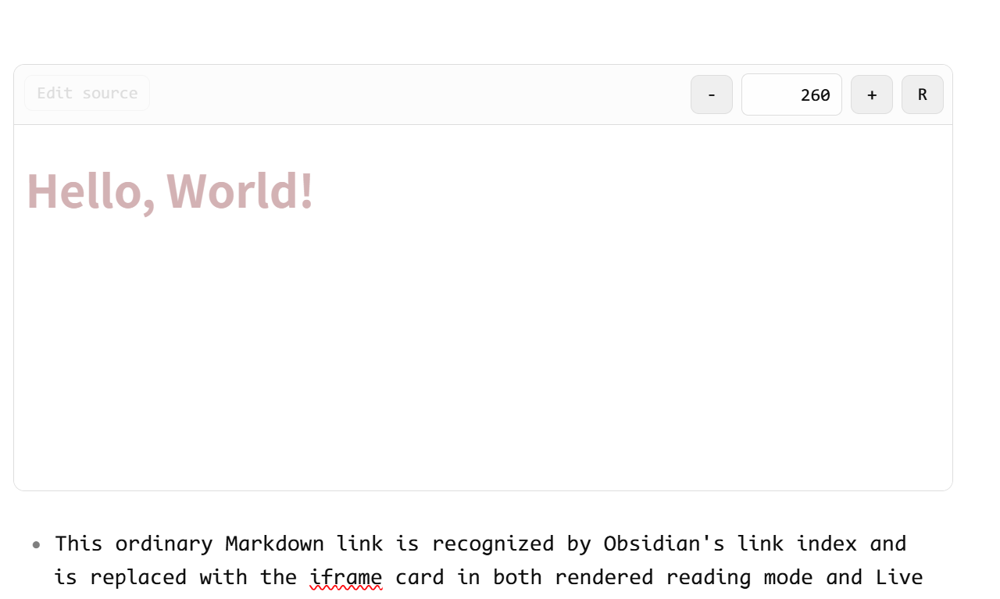

# Local HTML Card

Embed local HTML slides and interactive cards in Obsidian notes. Renders as a resizable iframe with optional height controls, in both Reading mode and Live Preview.

## Usage

### Markdown link (recommend)


```markdown
[html-card height=720](./assets/example.html)
```

The link text must start with `html-card`. The link target must end in `.html` or `.htm`.

### Code block(deprecated)


```local-html-card
./assets/example.html
height=720
```

The first line without a `=` is treated as the file path. Paths are resolved relative to the current note.

## Parameters

| Parameter   | Default           | Description                                                               |
| ----------- | ----------------- | ------------------------------------------------------------------------- |
| `height`    | `760`             | Initial iframe height in pixels                                           |
| `minHeight` | `260`             | Lower bound for manual height changes                                     |
| `maxHeight` | `2400`            | Upper bound for manual height changes                                     |
| `step`      | `80`              | Pixel increment per `-` / `+` click                                       |
| `controls`  | `true`            | Show the `-` / `+` / `R` toolbar (`false` to hide)                        |
| `mode`      | `inline`          | `inline` loads via `srcdoc`; `resource` loads via Obsidian's resource URL |
| `title`     | *(file basename)* | Accessible `title` on the iframe                                          |

Parameters can be written as `<key>=<value>` lines in a code block, or as space/comma-separated tokens inside the `[html-card ...]` link text.

## HTML Requirements

- HTML files should be self-contained — inline CSS and JavaScript, no network dependencies.
- `alert`, `confirm`, and `prompt` are disabled inside the iframe.
- Use Obsidian CSS variables (`--background-primary`, `--text-normal`, etc.) to support both light and dark themes.
- Store HTML files under the vault's `assets/` directory and reference them with relative paths.

## Live Preview

In Live Preview, the Markdown link line is replaced with the rendered card. Move the cursor onto the line or click **Edit source** to reveal and edit the original Markdown.



## Installation

Copy `main.js`, `styles.css`, and `manifest.json` into `Vault/.obsidian/plugins/local-html-card/` and enable the plugin in Settings → Community plugins.
